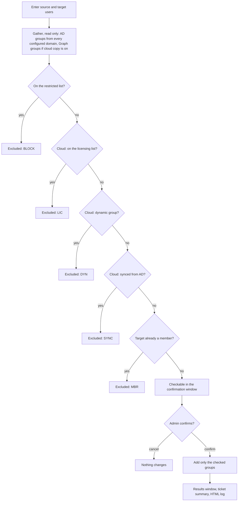
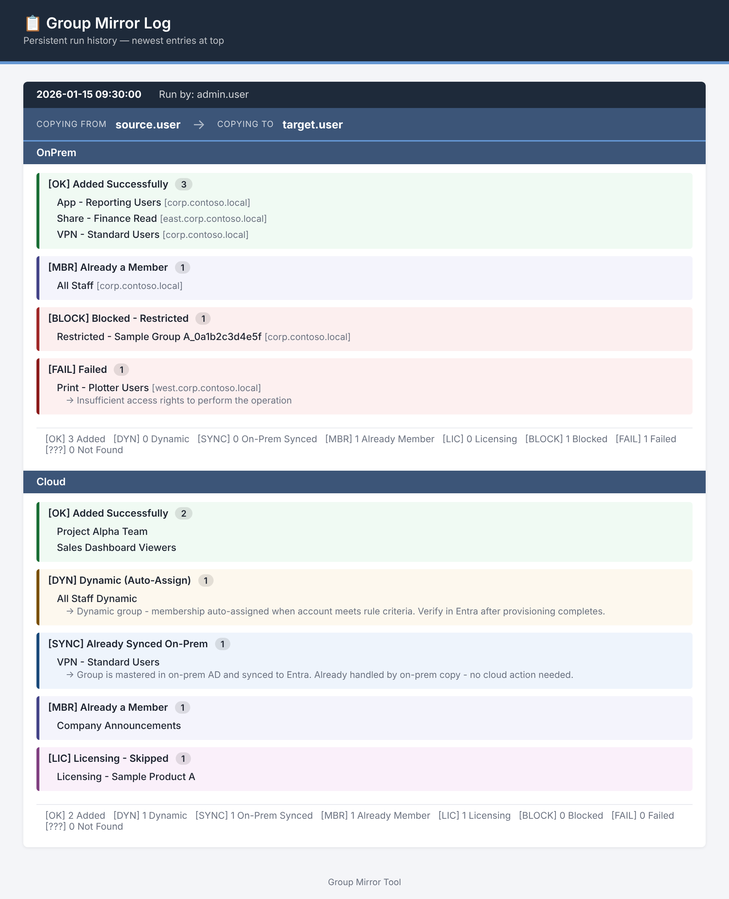

# AD and Entra ID Group Mirror

A Windows PowerShell GUI tool that copies one user's group memberships to another user, across a multi-domain on-premises Active Directory forest and Microsoft Entra ID, in a single run. Admins review everything in a confirmation window before anything changes, and get a ticket-ready summary afterward.

Typical use: a new hire or role change needs "the same access as a colleague."

## What it does

1. The operator enters a **source** user (copy from) and a **target** user (copy to). On-prem accepts `DOMAIN\name`, a SAM name, or a UPN. Cloud copy requires the full UPN for both users.
2. **Gather (read only).** It finds both users across every configured AD domain and reads both users' cloud memberships from Microsoft Graph.
3. **Confirm.** A three-column window lists:
   - **On-prem** groups that can be copied (checkboxes)
   - **Cloud** groups that can be copied (checkboxes)
   - **Excluded** groups, each with the reason it is skipped

   Select All and Deselect All buttons apply to both checkbox columns (Reset returns to the default, which is everything checked), and the Confirm button shows a live count of selected groups.
4. **Execute.** Only the approved groups are added.
5. **Report.** Results appear in the window. **Copy to Clipboard** formats them for a ticket, and each run is added to the top of a single HTML log.

### Result tags

| Tag | Meaning |
|---|---|
| `[OK]` | Added |
| `[DYN]` | Dynamic group; membership comes from its rule once the account qualifies |
| `[SYNC]` | Cloud group mastered in on-prem AD, so the on-prem half handles it |
| `[MBR]` | Target is already a member |
| `[LIC]` | Licensing group; assign manually by role |
| `[BLOCK]` | Restricted group; never mirrored |
| `[FAIL]` | The add was attempted and refused, with the error |
| `[???]` | Group is in the membership list but can no longer be resolved |

### Exclusions

- **Licensing groups** (`$Script:LicensingExclusionsRef`): skipped on the cloud side so copying access never assigns licenses.
- **Restricted groups** (`$Script:DoNotMirrorRef`): blocked on both sides. Matched by exact name or prefix, so names with a generated suffix are still caught.
- **Safety net:** any cloud group whose name contains "licens" but is on neither list triggers one prompt per run: skip all, add all, or decide each.

The lists in this repo are samples. Replace them with your own group names.

## Examples

All examples below were produced by the tool's own functions, run against placeholder users and groups with Active Directory and Graph faked.

### How a run flows



### Ticket summary

What **Copy to Clipboard** produces for that run:

```
Group Mirror - 2026-01-15 09:30:00
Source (copying FROM): source.user
Target (copying TO):   target.user

-- OnPrem --------------------------

[OK]   Added Successfully (3)
   * App - Reporting Users [corp.contoso.local]
   * Share - Finance Read [east.corp.contoso.local]
   * VPN - Standard Users [corp.contoso.local]

[MBR]  Already a Member (1)
   * All Staff [corp.contoso.local]

[BLOCK] Blocked - Restricted Group (1)
   * Restricted - Sample Group A_0a1b2c3d4e5f [corp.contoso.local]

[FAIL] Failed (1)
   * Print - Plotter Users [west.corp.contoso.local]
     --> Insufficient access rights to perform the operation

Summary: [OK]   3  [DYN]  0  [SYNC] 0  [MBR]  1  [LIC] 0  [BLOCK] 1  [FAIL] 1  [???]  0

-- Cloud --------------------------

[OK]   Added Successfully (2)
   * Project Alpha Team
   * Sales Dashboard Viewers

[DYN]  Dynamic (Auto-Assign) (1)
   * All Staff Dynamic
     --> Dynamic group - membership auto-assigned when account meets rule criteria. Verify in Entra after provisioning completes.

[SYNC] Already Synced On-Prem (1)
   * VPN - Standard Users
     --> Group is mastered in on-prem AD and synced to Entra. Already handled by on-prem copy - no cloud action needed.

[MBR]  Already a Member (1)
   * Company Announcements

[LIC]  Licensing Group - Skipped (1)
   * Licensing - Sample Product A

Summary: [OK]   2  [DYN]  1  [SYNC] 1  [MBR]  1  [LIC] 1  [BLOCK] 0  [FAIL] 0  [???]  0
```

### HTML log

Each run is added to the top of one HTML file:



## How it is built

- **Windows PowerShell 5.1** and **WinForms**, targeting Windows Server 2016 with no extra modules beyond RSAT ActiveDirectory.
- **On-prem:** the ActiveDirectory module, running as the signed-in admin. Searches each configured domain, resolves each group's own domain from its DN, and adds members with a live `ADUser` object so cross-domain adds work.
- **Cloud:** raw Microsoft Graph REST calls (client credentials flow), so no Graph module is needed on a server that cannot reach the PowerShell Gallery.
- **Secret storage:** the app's client secret is encrypted with DPAPI (`LocalMachine` scope) on first run and decrypted at runtime.
- **Optional:** compiled to an EXE with PS2EXE for double-click use.

## Repository contents

| Path | Purpose |
|---|---|
| `Group-Mirror.ps1` | The tool |
| `config.example.json` | Settings template. Copy to `config.json` (git-ignored) and fill in |
| `tests/Group-Mirror.Tests.ps1` | Pester 4 tests with Active Directory and Graph mocked |
| `PSScriptAnalyzerSettings.psd1` | Analyzer rules for PowerShell 5.1 on Server 2016 |
| `docs/BUILD-NOTES.md` | Problems found during the build and why each fix worked |
| `docs/images/sample-log.png` | Sample HTML log from a placeholder run |

## Deploy

**1. App registration (Entra ID)**

Create an app registration with these **Application** permissions and grant admin consent:

| Permission | Why |
|---|---|
| `User.Read.All` | Look up both users |
| `Group.ReadWrite.All` | Read group properties and memberships, and add members |

Create a client secret.

**2. Server**

```
C:\Group-Mirror\
    Group-Mirror.ps1
    config.json
    Logs\
```

Copy `config.example.json` to `config.json` and fill in the tenant ID, client ID, client secret and your AD domains. Leave `SecretEncrypted` as `false`. The first run encrypts the secret and sets it to `true`.

Restrict the folder to your admin group and `SYSTEM`. Anyone who can read `config.json` on the server can use the secret.

**3. Run**

```powershell
powershell.exe -NoProfile -ExecutionPolicy Bypass -File "C:\Group-Mirror\Group-Mirror.ps1"
```

Or compile on a workstation that can reach the PowerShell Gallery, and copy the EXE to the server:

```powershell
Install-Module ps2exe -Scope CurrentUser
Invoke-PS2EXE .\Group-Mirror.ps1 .\Group-Mirror.exe -noConsole
```

**Rotating the secret:** paste the new plaintext secret into `config.json`, set `SecretEncrypted` to `false`, and run once.

## Test

```powershell
Install-Module PSScriptAnalyzer, Pester -Scope CurrentUser
Invoke-ScriptAnalyzer -Path .\Group-Mirror.ps1 -Settings .\PSScriptAnalyzerSettings.psd1
Invoke-Pester -Path .\tests
```

The tests use Pester 4 syntax. They load the script's functions without opening the GUI, then mock Active Directory and Graph. They cover input parsing, the block and licensing rules, the confirmation filter (including a regression test for Deselect All), cross-domain lookups, result statuses, failure reporting and clipboard output. The DPAPI test only runs on Windows.

## Design decisions

- **Preview before writing.** Nothing changes until an admin confirms the exact list, and every excluded group is shown with its reason.
- **Never guess a domain.** Cloud lookups need the full UPN. Appending a default domain could target the wrong account.
- **Report, do not hide.** Unreachable domains, unresolvable groups and failed sign-ins are shown in the results instead of being dropped.
- **Least change on the server.** Raw REST instead of the Graph module, and no dependencies beyond what Windows Server 2016 already ships.
- **One log file.** A single HTML file with the newest run on top, instead of a folder of files.
- **ASCII-only source.** PowerShell 5.1 misreads UTF-8 without a BOM, so status tags are plain text.

## Known limits

- **The secret lives on the server.** DPAPI protects it at rest, but a local administrator on that server can still use it. Delegated sign-in, where each admin signs in with their own account and MFA, would remove the stored secret entirely.
- **`Group.ReadWrite.All` is tenant-wide.** It cannot change role-assignable groups, but it can change any other group.
- **Prefix matching** on the restricted list can over-match a group that starts with the same text.
- **Cross-domain adds to Global groups** fail by AD design and are reported as `[FAIL]`.
- **The cloud preview and execute phases** each read memberships from Graph, so Graph is called twice per run.
- **Unlisted licensing groups** show as checked in the confirmation window. The skip-or-add prompt for them appears during the execute phase, not in the preview.
- **If a user cannot be found on-prem** (no match, more than one match, or domains unreachable), the preview simply shows no on-prem groups. The reason is logged during the execute phase.
- **The automated tests cover the logic, not the WinForms layout.** GUI behavior was verified by hand during the build.

## How AI was used

This tool was built with an AI assistant (Claude). The AI wrote most of the code and diagnosed errors from screenshots and logs.

The author defined what the tool had to do, ran every build on the real server, reported each failure from real runs, and made the design calls: the confirmation window, which groups to exclude, the permission scope, the secret storage approach, and refusing to auto-fill domains. The author also required automated testing, which caught two bugs the AI had introduced or missed (see `docs/BUILD-NOTES.md`, item 16).
